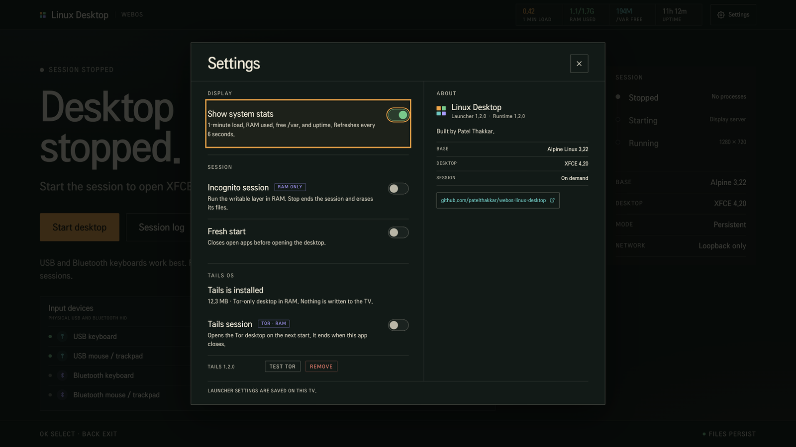
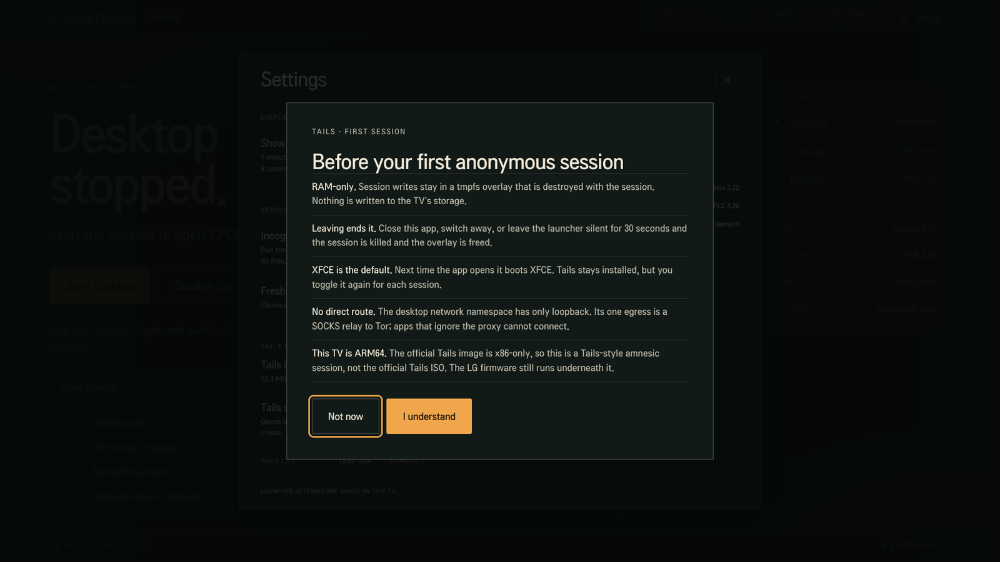
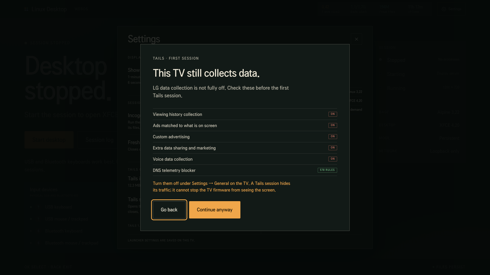

# Linux Desktop for webOS TVs

Alpine Linux XFCE on a rooted LG TV, started from a webOS launcher and shown
through noVNC.


Tested on an LG webOS TV running webOS 10.3.1 with an ARM64 kernel and 1.7 GB of
RAM. Other rooted ARM64 webOS TVs may work. A 32-bit-only TV will not run it.

## What you get and need

- Alpine 3.22, XFCE 4.20, 1280 × 720, software rendered. NetSurf 3.11, Terminal,
  Thunar, Mousepad, and a small App Store.
- Settings for live stats, USB and Bluetooth input, incognito, fresh start,
  Tails session, and About. Startup is on demand, with no boot hook.
- A rooted LG webOS TV with SSH and Homebrew Channel, webOS 10.0 or newer
  (tested on 10.3.1), about 350 MB free on `/var`, a USB or Bluetooth keyboard
  and mouse, and network access. The Magic Remote is a pointer, not a keyboard.
- Install needs `ssh`, `scp`, `curl`. Build needs ARM64 Linux with `sudo`,
  `curl`, `tar`, `squashfs-tools`, and Node.js 20 or newer.

## Install

The Homebrew package is the launcher. The runtime is a separate 137 MB download.

Runtime:
```sh
curl -LO https://github.com/patelthakkar/webos-linux-desktop/releases/latest/download/linux-desktop-runtime.tar
scp linux-desktop-runtime.tar root@YOUR_TV:/tmp/
ssh root@YOUR_TV 'mkdir -p /var/lib/webosbrew/linux-desktop && tar -xf /tmp/linux-desktop-runtime.tar -C /var/lib/webosbrew/linux-desktop && chmod 755 /var/lib/webosbrew/linux-desktop/*.sh'
```

Check the image with `sha256sum -c rootfs.squashfs.sha256` on the TV, or
`shasum -a 256 -c` on macOS. `bash tv/install.sh` does the same from source.

Launcher:
```sh
npm install
npm run package
ares-install dist/io.github.patelthakkar.linuxdesktop_1.2.0_all.ipk
```

Add `-d <name>` for multiple `ares` devices. If `ares-install` fails with
`Unable to exec`, run `TV_HOST=192.0.2.10 python3 tv/install-app.py`.

Open Linux Desktop and select Start desktop. The first start can take 10 to 20
seconds. Setup required means the runtime is missing.

The Tails layer is optional. Install it from Settings after the runtime is in
place. See [Tails session](#tails-session).

## Tails session



Tails is an amnesic desktop that lives only in RAM. Settings → Tails OS → Install
downloads a 5.8 MB layer, checks its SHA-256, and leaves it on the TV. Nothing is
enabled until you turn on the Tails switch and start a session.

The official Tails image runs on x86-64 computers. This TV is ARM64, so the
layer is a Tails-style session built from Alpine and Tor, not the Tails ISO.
The layer gives you the parts that matter here: no disk writes, Tor-only
networking, and a session that ends with the app.

What a session does:

- Starts XFCE with a 384 MiB tmpfs overlay. Files, downloads, and settings made
  inside it disappear when it stops.
- Runs Tor in the TV's network namespace and puts the desktop in its own network
  namespace with nothing but loopback. A small relay bridges the desktop's
  SOCKS port to Tor. Apps that ignore the proxy cannot reach the network at all.
- Sets `TZ=UTC` and points `http_proxy`, `https_proxy`, and `ALL_PROXY` at the
  local SOCKS relay. NetSurf uses libcurl, so HTTPS goes through Tor.
- Sends a heartbeat from the launcher every 5 seconds. Closing the app, switching
  away from it, or losing the launcher for 30 seconds stops the session and
  destroys the RAM overlay. A watchdog on the TV enforces the timeout even if the
  launcher crashes.
- Resets the Tails switch after the session. The next time the app opens, Start
  desktop boots normal XFCE. Tails stays installed and you toggle it again.

The first start runs two checks.

The telemetry check reads the TV's own settings: Live Plus, viewing history,
screen-saver ads, ACR consent and ads, custom ads, data sharing, voice, and
remote diagnostics. It also reports whether a DNS telemetry blocker is active.
If anything is on, the launcher shows what it found before the first session.
It does not change TV settings for you.

The notice explains the RAM-only overlay, the 30-second timeout, the one-shot
toggle, the scoped Tor route, and the ARM64 limitation. Both dialogs store their
acknowledgement on the TV, so they appear once per install.





Use **Test Tor** in Settings while a session runs to ask
`check.torproject.org` through the proxy. It reports whether the exit is a Tor
node.

Removing the layer does not touch the TV's files or settings. Remove it from
Settings, or run `control.sh tails-remove` on the TV.

### What it does not protect

The TV firmware runs below the session. LG can still see what the panel shows,
and the TV's own services keep their network access. Tor hides the destination
of the desktop's traffic from the local network, not the fact that the TV is
online. This is not a substitute for Tails on a laptop when the threat includes
the TV manufacturer or the network operator.

The session shares the TV's RAM and CPU. It needs about 500 MB free to start and
refuses below that.

## Settings

Open the gear in the launcher top bar or the desktop bar.

- Show system stats puts 1-minute load, RAM used and total, free `/var`, and
  uptime in the top bar, refreshed every 6 seconds.
- Incognito uses a 256 MiB RAM overlay. Stop erases its files. Closing the app
  leaves it running until Stop. It refuses below 400 MiB free RAM.
- Fresh start closes the running session before opening the desktop, with a
  confirmation when work will be lost.
- Tails OS installs and controls the Tor session described above. The switch is
  one session only and turns off when that session ends.
- About shows Launcher and Runtime 1.2.0, Patel Thakkar, the repository URL, and
  the Alpine Linux and XFCE versions.

Input rows show Detected with the device name, or Not connected. Refresh reads
the TV kernel with the stats. Settings save on the TV; Incognito, Fresh start,
and Tails apply on the next start.

## Use

Start desktop, Open desktop, Controls, Stop desktop, and Session log. Files under
`/home/desk` persist except in incognito or Tails. The desktop does not start on
boot. The 1280 × 720 software-rendered display handles a terminal, text editing,
the browser, and small tools. It is not for video or gaming.

## Browser

NetSurf is on the panel and in the Applications menu. HTTPS uses the system CA
certificates, and downloads go to `/home/desk/Downloads`. Simple sites render;
JavaScript-heavy sites, video, and many web apps do not. The download dialog
uses stock labels such as `document-save`; choose the left save button. There is
no tab sandbox, ad blocking, or password manager. Do not use it for banking,
email, or sites that need a current browser.

## App Store

The bag icon installs extra Alpine packages into the desktop, separate from
Homebrew Channel. Packages are signed by Alpine and verified by `apk`; the store
never uses `--allow-untrusted`. Installs persist unless Incognito or Tails is on.
The App Store is disabled inside a Tails session because its daemon fetches
packages outside Tor.

The store refuses below 64 MB free, removes its APK index after every job,
protects base packages, and accepts only catalog IDs through a root helper. The
catalog covers terminal tools, a file manager, a calculator, an image viewer, and
a screenshot tool.

## SSH tunnel

Both ports listen on loopback only:

```sh
ssh -N -o ExitOnForwardFailure=yes -L 127.0.0.1:6080:127.0.0.1:6080 root@YOUR_TV
```

Open <http://127.0.0.1:6080/vnc.html?autoconnect=true&resize=scale>. There is no
VNC password because neither port is on the LAN; the SSH tunnel authenticates.

## Build

The build needs ARM64 Linux and `sudo`; it does not touch the TV.

```sh
npm install
bash build/build-rootfs.sh
bash build/build-tails.sh
npm test
npm run package
bash release.sh
```

The runtime image is `artifacts/rootfs.squashfs`. The optional layer is
`artifacts/tails.squashfs`. Set `DESKTOP_BUILD_DIR` or `TAILS_BUILD_DIR` to change
a build directory. Alpine verifies signed packages, top-level versions are pinned
in `build/packages.lock`, and the release SHA-256 pins both artifacts. Deploy with
`TV_HOST=192.0.2.10 TV_KEY=~/.ssh/your_tv_key bash tv/install.sh`.

`build/build-tails.sh` adds Tor 0.4.9, torsocks 2.5, socat 1.8, and iproute2 to a
small Alpine chroot, then copies the session scripts from `build/tails/`. It
refuses to build if a package would be upgraded, so the layer cannot silently
depend on a different libc or OpenSSL than the runtime.

## Release

Upload everything in `dist/` to a GitHub release tagged with the app version:
`linux-desktop-runtime.tar`, `linux-desktop-tails.squashfs`, both `.sha256`
files, `io.github.patelthakkar.linuxdesktop_1.2.0_all.ipk`,
`io.github.patelthakkar.linuxdesktop.manifest.json`, and `SHA256SUMS`.

Then fork [webosbrew/apps-repo](https://github.com/webosbrew/apps-repo), copy
`homebrew/io.github.patelthakkar.linuxdesktop.yml` into `packages/`, and open a
pull request. The URLs assume `patelthakkar/webos-linux-desktop`; update
`scripts/make-manifest.js`, the Homebrew YAML, and `SETUP_URL` in
`webos-app/app.js` if you publish under another name.

The launcher reads the Tails download from `TAILS_URL` in `tv/control.sh`. Point
it at your release if you fork the project.

## Limits

- No audio, no GPU acceleration, no Firefox or Chromium. NetSurf is limited and
  the App Store catalog is curated and does not auto-update packages.
- ARM64 only. The launcher refuses below 96 MB free on `/var`; a running session
  stops below 64 MB.
- Input detection reads the TV kernel. Passing those devices into the chroot is
  not supported. The chroot shares the TV kernel and network; do not run
  untrusted software.
- The TV's 1.7 GB of RAM is shared with webOS. Close other apps and stop the
  desktop when you are not using it.
- A Tails session uses the TV's network stack through Tor, but it cannot hide
  the TV from LG or from someone watching the LAN. It is not the Tails ISO and
  is not hardened to the same level.

## Uninstall

```sh
TV_HOST=192.0.2.10 python3 tv/remove-app.py
ssh root@YOUR_TV '/var/lib/webosbrew/linux-desktop/control.sh stop'
ssh root@YOUR_TV 'rm -rf /var/lib/webosbrew/linux-desktop'
```

The runtime adds no boot service. App Store packages and the Tails layer live
inside the same directory; back up anything in `/home/desk` first.

## License

The launcher and build scripts are MIT licensed. See `LICENSE`. The runtime and
Tails layer contain third-party packages under their own licenses. See
`THIRD-PARTY.md` before redistributing either image.
