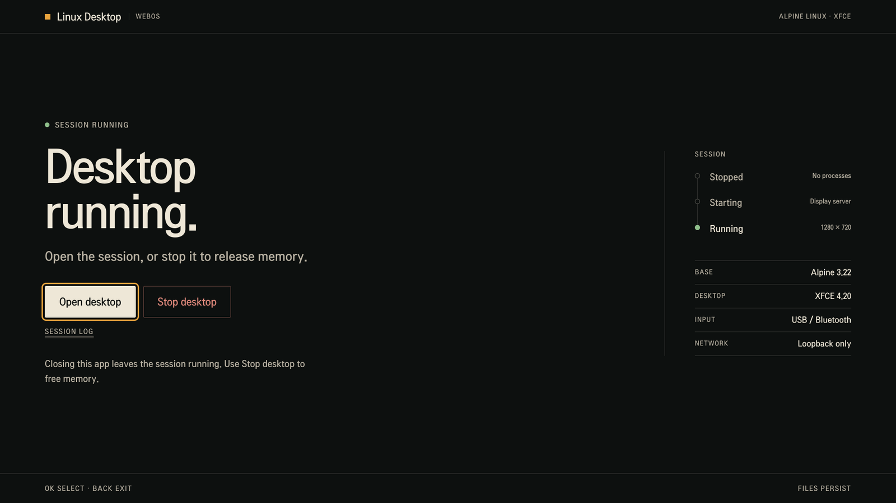
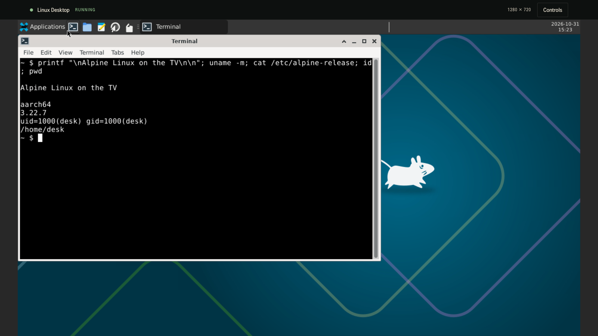
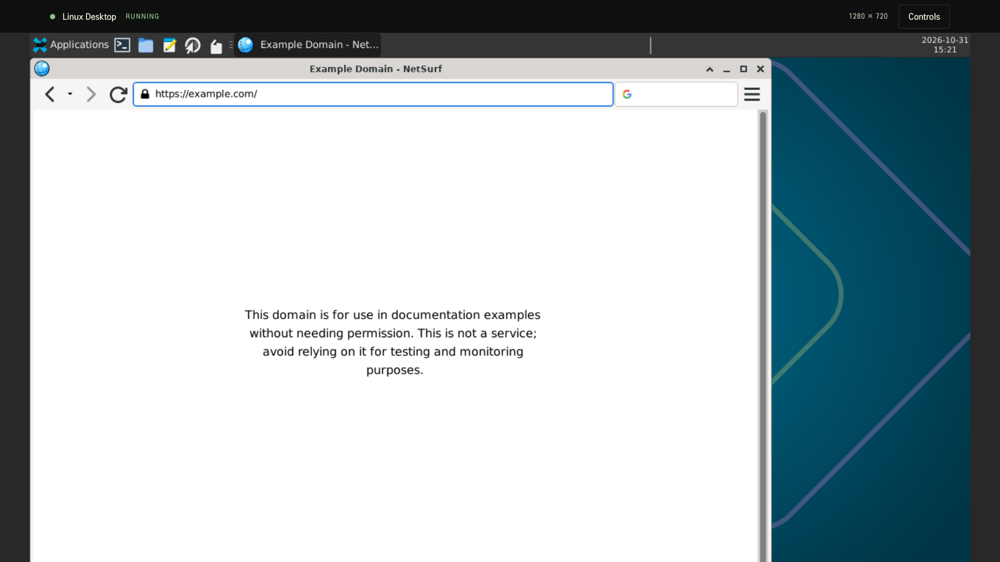
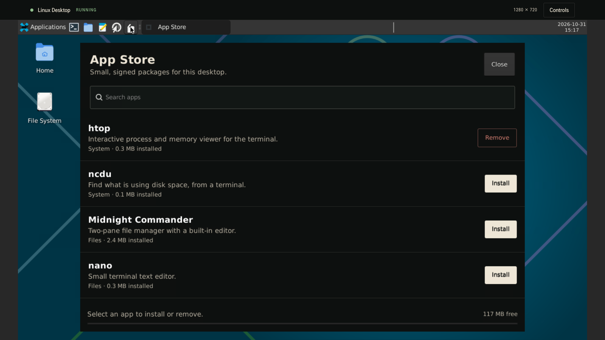

# Linux Desktop for webOS TVs

A native Alpine Linux desktop on a rooted LG TV. It runs XFCE, NetSurf, and a
small App Store inside a chroot; the TV app shows the session through noVNC.









Tested on an LG webOS TV running webOS 10.3.1 with an ARM64 kernel and 1.7 GB of
RAM. Other rooted ARM64 webOS TVs may work. A 32-bit-only TV will not run the
ARM64 image.

## What is inside

- Alpine 3.22 and XFCE 4.20 at 1280 × 720, software rendered.
- NetSurf 3.11, a small browser with HTTPS and downloads.
- An App Store with a curated set of small, signed Alpine packages.
- XFCE Terminal, Thunar, Mousepad, and a few desktop utilities.
- On-demand startup. No boot hook and no always-on TV service.

## Requirements

- A rooted LG webOS TV with SSH access and Homebrew Channel.
- webOS 10.0 or newer. The Homebrew listing uses that minimum; this was tested
  on webOS 10.3.1.
- About 350 MB free on `/var` for the runtime image and user files.
- A USB or Bluetooth keyboard and mouse. The Magic Remote works as a pointer,
  but it is not a keyboard.
- Network access for App Store installs and web browsing.
- For the install: a computer with `ssh`, `scp`, and `curl`.
- For building: Linux on ARM64 with `sudo`, `curl`, `tar`,
  `squashfs-tools`, and Node.js 20 or newer.

The runtime is an ARM64 Alpine image. It does not emulate another architecture,
so the CPU runs Linux code directly.

## Install

The Homebrew package is only the launcher. The runtime is a separate download
because it does not belong in the app package.

### 1. Install the runtime

Download the latest release archive, copy it to the TV, and unpack it:

```sh
curl -LO https://github.com/patelthakkar/webos-linux-desktop/releases/latest/download/linux-desktop-runtime.tar
scp linux-desktop-runtime.tar root@YOUR_TV:/tmp/
ssh root@YOUR_TV 'mkdir -p /var/lib/webosbrew/linux-desktop && tar -xf /tmp/linux-desktop-runtime.tar -C /var/lib/webosbrew/linux-desktop && chmod 755 /var/lib/webosbrew/linux-desktop/*.sh'
```

Replace `YOUR_TV` with the TV's address. The archive contains the image, the
two control scripts, and the third-party notice. It does not install a boot
service.

Check the image:

```sh
ssh root@YOUR_TV 'cd /var/lib/webosbrew/linux-desktop && sha256sum -c rootfs.squashfs.sha256'
```

On macOS, use `shasum -a 256 -c rootfs.squashfs.sha256` instead. If you are
building from source, `bash tv/install.sh` does the same thing and refuses to
leave less than 100 MB free.

### 2. Install the launcher

Install **Linux Desktop** from Homebrew Channel. For a local build:

```sh
npm install
npm run package
ares-install dist/io.github.patelthakkar.linuxdesktop_1.0.0_all.ipk
```

You need a configured `ares` device first. Add `-d <name>` if you have more
than one device. The [webOS Homebrew development
guide](https://www.webosbrew.org/develop/) covers that setup.

If `ares-install` fails with `Unable to exec`, use the installer that goes
through the TV's own install service:

```sh
TV_HOST=192.0.2.10 python3 tv/install-app.py
```

This is a known CLI problem on some rooted TVs, not an app problem.

### 3. Start it

Open **Linux Desktop** from the TV app list and select **Start desktop**. The
first start can take 10 to 20 seconds. The desktop opens when the display server
is ready. If the app opens with **Setup required**, the runtime is missing; use
the setup guide or follow step 1.

## Use

- **Open desktop** shows the XFCE session.
- **Controls** returns to the launcher without stopping Linux.
- **Stop desktop** closes the session and frees memory. Save your work first.
- **Session log** shows the latest start log, which is useful when a start fails.

Files under `/home/desk` survive stop and start; the overlay is on `/var`.
The desktop does not start automatically after a reboot. Open the app and start
it again.

The display is 1280 × 720 and software rendered. It is enough for a terminal,
text editing, the browser, and small tools. It is not a video or gaming desktop.

## Web browser

NetSurf is on the panel (the globe icon) and in the Applications menu. It is a
small HTML/CSS browser, not a replacement for a modern browser:

- HTTPS works. It uses the system CA certificates.
- Downloads work. The browser is started with
  `--downloads_directory=/home/desk/Downloads`.
- Simple, mostly static sites render. JavaScript-heavy sites, video, and many
  modern web apps do not.
- NetSurf 3.11's download dialog uses stock button labels such as
  `document-save`; choose the left save button.
- There is no tab sandbox, ad blocking, or password manager.

NetSurf is a deliberate trade for memory and disk use. Do not use this desktop
for banking, email, or other sites that require a current browser.

## App Store

The bag icon opens a small store that installs extra Alpine packages into the
desktop. It is separate from Homebrew Channel and does not install webOS apps.

- Search the curated catalog, install, and remove.
- Packages are signed by Alpine and verified by `apk`; the store never uses
  `--allow-untrusted`.
- Installs live in the persistent overlay and survive stop and start.
- The catalog is deliberately small: terminal tools, a file manager, a
  calculator, an image viewer, and a screenshot tool. It is not a general APK
  front end.
- The store refuses installs when less than 64 MB is free.
- The APK index is removed after every job. Packages are not cached.
- Base packages such as XFCE, NetSurf, Python, TigerVNC, and noVNC are protected.
- Removing an app keeps files in `/home/desk`.

The store's small root helper runs inside the chroot and accepts only catalog
IDs over a Unix socket owned by the desktop user. It does not expose a shell or
arbitrary package names.

| Package | What it adds | Approx. installed |
| --- | --- | --- |
| htop | Process and memory viewer | 0.3 MB |
| ncdu | Disk usage browser | 0.1 MB |
| Midnight Commander | Two-pane file manager | 2.4 MB |
| nano | Terminal editor | 0.3 MB |
| rsync | File synchronization | 0.5 MB |
| tmux | Terminal sessions | 0.8 MB |
| galculator | Calculator | 0.8 MB |
| Ristretto | Image viewer | 0.3 MB |
| Screenshot | XFCE screenshot tool | 0.3 MB |

## Remote access

Both ports listen on loopback only. Use an SSH tunnel:

```sh
ssh -N -o ExitOnForwardFailure=yes -L 127.0.0.1:6080:127.0.0.1:6080 root@YOUR_TV
```

Then open <http://127.0.0.1:6080/vnc.html?autoconnect=true&resize=scale>.

For a native VNC viewer, forward the VNC port instead:

```sh
ssh -N -o ExitOnForwardFailure=yes -L 127.0.0.1:5907:127.0.0.1:5907 root@YOUR_TV
vncviewer 127.0.0.1:5907
```

There is no VNC password because neither port is exposed to the LAN. The SSH
tunnel provides the authentication.

## How it works

The TV app calls Homebrew Channel's root `exec` method to run
`/var/lib/webosbrew/linux-desktop/control.sh`. That script starts a private
mount, PID, and UTS namespace, mounts a read-only squashfs image with a
persistent overlay, and runs the desktop as an unprivileged user.

Inside the namespace:

- TigerVNC serves a 1280 × 720 X display on `127.0.0.1:5907`.
- websockify serves noVNC on `127.0.0.1:6080`.
- XFCE runs as UID 1000 with a reduced capability set.
- The App Store helper runs as root but only handles its package allowlist.
- The browser and store are children of the session and exit with it.

Stopping kills the namespace supervisor. The kernel then removes every process
and mount in the session. No boot hook and no system service are installed.

This is not a security boundary. The chroot shares the TV kernel and network.
Do not run untrusted software in it.

## Resource use

The desktop and display stack idle at roughly 340 MB of RSS on this TV.
NetSurf and the App Store add memory while they are open; the App Store helper
is about 10 MB. The TV showed about 500 to 560 MB available with the desktop
running, depending on what else webOS had open. Stop the desktop when you are
done.

The current runtime image is about 137 MB.
The browser and store do not add a package cache, and the store removes its
index after every job. The App Store packages are between 0.1 and 2.4 MB.

## Build from source

The build needs an ARM64 Linux host. It uses `sudo` to assemble the image and
write the root-owned files; it does not touch the TV.

```sh
npm install
bash build/build-rootfs.sh
npm test
npm run package
```

The image is written to `artifacts/rootfs.squashfs`. Set `DESKTOP_BUILD_DIR`
to change the temporary build directory. The build checks the Alpine minirootfs
checksum and Alpine verifies its signed packages. Top-level package versions are
pinned in `build/packages.lock`; the release image SHA-256 pins the full artifact.

Deploy the image and scripts to a rooted TV:

```sh
TV_HOST=192.0.2.10 TV_KEY=~/.ssh/your_tv_key bash tv/install.sh
```

`tv/install.sh` copies `rootfs.squashfs`, `control.sh`, and `namespace.sh`,
verifies the SHA-256, and refuses to leave less than 100 MB free. It does not
change TV settings or install a startup service.

If the webOS CLI fails to install the package, run
`TV_HOST=192.0.2.10 python3 tv/install-app.py`.

## Release and Homebrew submission

`release.sh` builds the runtime archive, the `.ipk`, and the Homebrew manifest:

```sh
bash release.sh
```

Upload everything in `dist/` to a GitHub release tagged with the app version.
The release must include:

- `linux-desktop-runtime.tar`
- `io.github.patelthakkar.linuxdesktop_1.0.0_all.ipk`
- `io.github.patelthakkar.linuxdesktop.manifest.json`
- `SHA256SUMS`

Then fork [webosbrew/apps-repo](https://github.com/webosbrew/apps-repo), copy
`homebrew/io.github.patelthakkar.linuxdesktop.yml` into `packages/`, and open a
pull request. The [publishing
guide](https://www.webosbrew.org/develop/guides/publishing/how-to/) describes
the repository format.

The manifest and listing URLs assume the repository is
`patelthakkar/webos-linux-desktop`. If you publish under another account or
name, update `scripts/make-manifest.js`, the Homebrew YAML, and `SETUP_URL` in
`webos-app/app.js`.

## Limits

- No audio. The chroot does not receive the TV's audio devices.
- No GPU acceleration. XFCE, NetSurf, and the store run on the CPU.
- Firefox and Chromium are not included. Memory is tight alongside webOS.
- NetSurf does not support most modern JavaScript-heavy sites.
- The App Store catalog is curated and does not auto-update packages.
- The image runs on ARM64 Linux only. It will not run on 32-bit-only webOS TVs.
- The launcher refuses to start with less than 96 MB free on `/var`; a running
  session stops below 64 MB.

The TV's 1.7 GB of RAM is shared with webOS. Close other apps and stop the
desktop when you are not using it.

## Uninstall

Remove the launcher:

```sh
TV_HOST=192.0.2.10 python3 tv/remove-app.py
```

Stop the desktop first, then remove its directory if you no longer need the
files:

```sh
ssh root@YOUR_TV '/var/lib/webosbrew/linux-desktop/control.sh stop'
ssh root@YOUR_TV 'rm -rf /var/lib/webosbrew/linux-desktop'
```

The runtime scripts do not add a boot service, so there is nothing else to
remove. App Store packages live inside the same directory and are removed with
it; back up anything in `/home/desk` first.

## License

The launcher and build scripts are MIT licensed. See `LICENSE`. The runtime
contains third-party packages under their own licenses. See `THIRD-PARTY.md`
before redistributing the runtime image.
